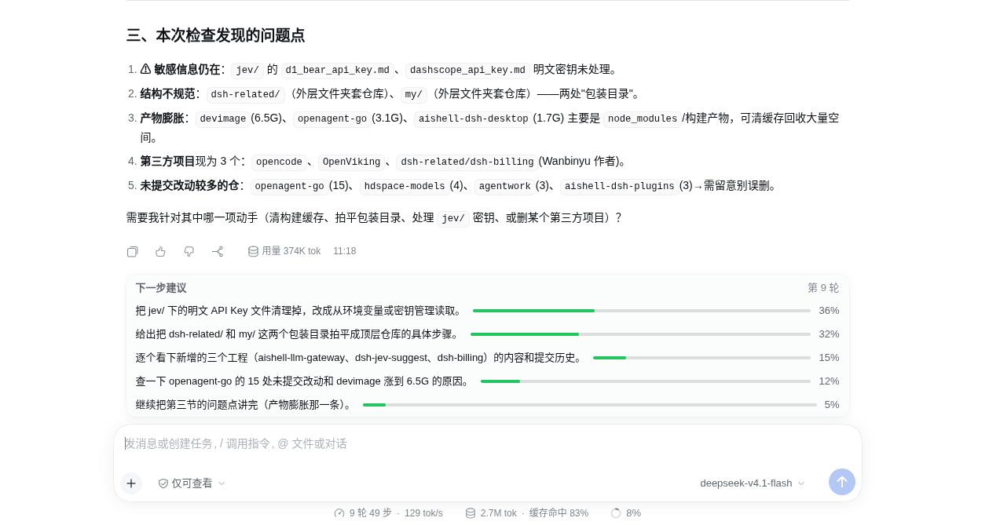

# @runzhi214/dsh-jev-suggest

每轮对话正常结束后，在输入框上方展示"下一步建议"——每条建议是一个可点击的 chip，附带校准过的概率。每轮两步：先用一次普通 LLM 调用（走 `ctx.llm`，即对话本身使用的服务）生成贴合上下文的候选，再由 DashScope `systemone` 决策模型对候选集打出概率分布——与 jev 工具路由同款 choice 协议，但不带 family gate（展示要的是完整分布，不是单一选择）。设计契约见 [doc/01-design.md](./doc/01-design.md)。



## 工作原理

```
session 事件:
  user/message ──────────→ goal
  assistant/message ─────→ 最新回复、轮次
  request/context ───────→ 生成调用使用的 provider/model
  turn/start ─────────────→ 中止 in-flight 计算，撤回 chips
  turn/end (completed) ──→ 进入管线:
    off / 无上下文 / TTL 去重 / 冷却 ⇒ 跳过（仅记观察日志）
    生成: 一次 ctx.llm 调用 → JSON [{id, label}] 候选
    打分: systemone choice 协议对候选集 → 概率
    过滤 (minDisplayProbability) → 排序 → 截断 (maxSuggestions) → 发布
    shadow 模式照常计算并记日志，但从不发布

浏览器半区 (conversation.input.dock):
  轮询 GET api/jev-suggest/suggestions?sessionId=…
  仅在已发布集合存在时渲染 chips；点击后通过 inputActions.setDraft
  把 label 预填进草稿，并 POST 遥测
```

任何失败——生成错误、打分错误、畸形输出——该轮 fail-closed（无 chips）；连续失败进入冷却，上游已挂时不会每轮空烧预算。点击指向旧代次 generation 的 chip 照常记录，但标记 `stale`。

## 配置

| 字段 | 类型 | 默认值 | 说明 |
|---|---|---|---|
| `mode` | `off` \| `shadow` \| `on` | `off` | 环境变量 `JEV_SUGGEST_MODE` 可按轮覆盖。`shadow` 计算并记日志但不发布。 |
| `provider` | `string` | `''` | 生成调用的固定 provider；留空 = 会话观察到的 route。 |
| `model` | `string` | `''` | 生成调用的固定 model；留空 = 会话观察到的 route。 |
| `systemoneBaseUrl` | `string` | `https://maas.qianwenaiapi.com/compatible-mode/v1` | systemone 服务地址。 |
| `systemoneModel` | `string` | `decision-model-preview` | systemone 模型 id。 |
| `systemoneApiKeyEnv` | `string` | `DASHSCOPE_API_KEY` | systemone API key 所在的环境变量名。key 永不进入配置文件、patch yml 或日志。 |
| `maxSuggestions` | `number` | `5` | 候选数上限，同时约束 prompt 与发布集合。 |
| `minDisplayProbability` | `number` | `0.05` | 概率低于该值的条目不发布。 |
| `generationTimeoutMs` | `number` | `20000` | 生成调用的墙钟预算。 |
| `systemoneTimeoutMs` | `number` | `3000` | systemone 单请求超时。 |
| `stateTtlMs` | `number` | `5000` | (goal, reply) 状态键未变化期间跳过重算。 |
| `failureThreshold` | `number` | `3` | 进入冷却前的连续上游失败次数。 |
| `failureCooldownMs` | `number` | `60000` | 冷却窗口，期间完全跳过上游。 |
| `logPath` | `string` | `''` | JSONL 观察日志（0600，best-effort）。只记录候选 id、概率、原因、耗时、会话短 id——不记录 label 文本、任务文本或凭据。 |

## 版本与兼容性

| 项 | 值 |
|---|---|
| 插件版本 | `0.0.1-beta.5`（与 `src/index.ts` 的 `PLUGIN_VERSION` 保持同步） |
| 兼容 DSH | `>=0.2.0-0 <0.3.0-0` —— 整个 `0.2.x` 线，含各 patch 的 alpha/rc 预发布；`0.3.0` 起拒绝 |
| 实测版本 | `0.2.0-rc.1`（开发/测试基线）、`0.2.1-alpha.1`（真机运行） |
| Node | `^22.19.0 || >=24.0.0` |
| 包管理器 | pnpm（开发用 `pnpm@11.7.0`） |

兼容范围由 `package.json` 的 peerDependencies（`@deepseek-ai/dsh-client-connection` / `@deepseek-ai/dsh-llm`）声明。DSH 处于 developer preview，API 可能 break：`0.3.0` 发布后需重新评估并调整范围。

## 安装

```sh
dsh plugin --profile <name> add link:<repo>
```

带配置：

```yaml
- insert:
    - id: jev-suggest
      name: '@runzhi214/dsh-jev-suggest'
      config:
        mode: on
        logPath: /home/<user>/.dsh/jev-suggest.jsonl
```

推荐首跑：`mode: shadow` 加 `logPath`，检查 `suggest_computed` 事件后再开 `on`。注意 `logPath` 不做 `~` 展开，请写绝对路径。

## 观察日志事件

| 事件 | 字段 | 触发时机 |
|---|---|---|
| `plugin_start` | version, mode, gate 参数 | 插件加载（时代标记） |
| `suggest_computed` | sid, turn, mode, count, elapsed_ms, items `[{id, p}]` | 计算出一个集合 |
| `suggest_skipped` | sid, reason（`no_context` / `no_provider` / `cooldown` / `ttl_dedup` / `below_display_threshold` / `no_session_id`） | 守卫拦截 |
| `suggest_error` | sid, reason, stage（`generate` / `score`） | 某步失败 |
| `suggest_click` | sid, id, stale | chip 被点击 |

## 安全说明

- API key 在调用时从 `systemoneApiKeyEnv` 指定的环境变量读取；绝不写入仓库、patch yml、config 对象或日志。
- 401 / 缺 key 通过 `logger.error` 单次上报；同时进入失败冷却。
- goal 与最新回复会送到生成模型与打分模型——本就是对话自身的输入输出已经到达过的面。观察日志只记录 id、概率、原因与耗时。
- 路由不改变任何东西：chips 只通过会话自身的 input actions 预填草稿；提交仍走普通 composer 路径，审批机制原样保留。

## 许可证

MIT。
